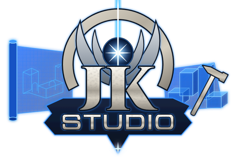

# JK Studio



**Mod tools for Jedi Knight: Jedi Academy and Jedi Outcast.**
Not affiliated with Lucasfilm, Disney or Raven Software.

JK Studio was called *BehavEd-Remake* up to rc605. It has three parts:

- **BehavEd** (scripts) – a remake of BehavEd, the ICARUS script editor from
  Raven's Jedi Academy SDK: open, edit and compile scripts (`.txt` / `.ibi`) –
  commands, macros and dialogs as in the original.
- **Preview** – BSP maps straight from the game archives, characters with
  animations, effects (`.efx`), sound, camera moves and an editable timeline;
  an ICARUS re-implementation (`src/ablauf.cpp`) plays cutscenes on the
  engine's 50 ms tick, the way the game does (Jedi Academy, Movie Duels,
  Jedi Outcast).
- **Map Editor** – menus, tools and shortcuts of NetRadiant-Custom, with the
  map compiler q3map2 built in (`bhed_q3map2.exe`), a build progress window,
  an optimizer for the game's limits, playing in the editor and a tutorial
  "Your first map".

Also: undo history, rolling backups, a built-in updater, English, German,
Chinese and Japanese, and a full guide with pictures, tutorials and search in
all four languages (Help → *Guide and tutorials*).

## Download

Open the [latest release](https://github.com/DennisHerrm/JK-Studio/releases/latest)
and, under **Assets**, download **`JK-Studio-rcNNN-windows-x64.zip`**
(Windows 10/11, 64-bit). *Source code (zip)* and *Source code (tar.gz)* are
for developers – they contain no program. Unzip the file (right-click →
*Extract All…*) and start `JK-Studio/jkstudio.exe`. Nothing is installed;
keep `jkstudio.exe` next to its `data` folder.

Just want the program? **`JK-Studio-rcNNN-windows-x64.exe`** from the same
release runs on its own: it carries its data and unpacks it to
`%APPDATA%\jkstudio\data\base` the first time. The offline guide and the map
compiler are only in the zip.

Coming from BehavEd-Remake? It updates itself to JK Studio (Help → *Check for
updates…*). Your settings move along: on the first start JK Studio copies
`%APPDATA%\behaved` to `%APPDATA%\jkstudio` (the old folder stays). The zip
still contains `behaved.exe` – the same program – so old shortcuts keep working.

The program is not code-signed, so Windows SmartScreen may warn the first time
("Windows protected your PC"): click **More info → Run anyway**.
`SHA256SUMS.txt` in the same release lists the checksums of both downloads.

Add your Jedi Academy / Movie Duels / Jedi Outcast game folders under
**Edit → Game folders**. The program updates itself from here
(Help → *Check for updates…*).

The guide (`handbuch/` next to `jkstudio.exe`) explains every function and
walks through tutorials: a first cutscene, a walking figure, a ship on a ROFF
path, a mission of your own and your first map. It works offline; open it from
Help → *Guide and tutorials*. Its source is in `tools/handbuch/`.

## Building

Windows, Visual Studio 2026 (18) with C++, CMake.

```
git clone --recurse-submodules https://github.com/DennisHerrm/JK-Studio.git
cd JK-Studio
build.bat
```

Details and known pitfalls are in [BAUEN.md](BAUEN.md), the tests in
[TESTING.md](TESTING.md), the change log in [AENDERUNGEN.md](AENDERUNGEN.md)
(the developer documentation and code comments are in German).

## Third-party content

- `imgui/` – [Dear ImGui](https://github.com/ocornut/imgui) (MIT), as a submodule.
- `third_party/minimp3.h` – minimp3 (CC0).
- `third_party/quickhull/` – QuickHull by Antti Kuukka (public domain), unchanged
  from NetRadiant-Custom (`libs/quickhull`); the map editor uses it for
  Snap to Grid of brushes like NetRadiant-Custom.
- `third_party/q3map2/` – the map compiler q3map2 (GPL v2) from the
  NetRadiant-Custom tag 20260114, unchanged; built as `bhed_q3map2.exe` for the
  map editor's Build menu. Its libraries, unchanged release sources:
  `third_party/zlib/` zlib 1.3.1 (zlib), `third_party/libpng/` libpng 1.6.53
  (PNG Reference Library License v2), `third_party/libjpeg-turbo/`
  libjpeg-turbo 3.1.3 (IJG, BSD 3-clause, zlib), `third_party/libxml2/`
  libxml2 2.15.1 (MIT), `third_party/assimp/` assimp 6.0.2 (BSD 3-clause).
  Provenance, the licence of every part and what was left out are in
  [third_party/q3map2/README.md](third_party/q3map2/README.md).
- The JK Studio logo and icon (`res/jkstudio_logo.*`, `res/jkstudio_icon.svg`,
  `res/jkstudio.ico`) are shank's design; their lettering is made from the
  fonts Cinzel and Michroma (SIL Open Font License 1.1, texts in `licenses/`).
- `data/` contains files from the Jedi Academy SDK and from the original
  `BehavEd.exe` (images, the command description `behaved.bhc`, headers such as
  `Q3_Interface.h` and `anims.h`). These are the property of Raven Software /
  Activision.
- Code ported from [NetRadiant-Custom](https://github.com/Garux/netradiant-custom),
  GtkRadiant and q3map2 (GPL v2): the map editor core in `src/karte/` and
  `include/bhed/karte/`, and the map editor workspace in `gui/app_karte*.cpp`
  (menus, toolbars, shortcuts, layouts as NetRadiant-Custom). Each ported file
  names its NetRadiant-Custom source files and keeps their copyright lines (Id
  Software, Inc. and the GtkRadiant / NetRadiant contributors). The toolbar
  icons are our own drawings (`gui/karte_vektoricons.cpp`) that keep the
  meaning of NetRadiant-Custom's icons at the same places. The
  shortcut matching follows Qt 5 (QKeySequence, QWindowsKeyMapper::possibleKeys,
  LGPL), as NetRadiant-Custom uses it; the pane, toolbar and status bar sizes
  follow Qt 5.15's layout code (qGeomCalc, QSplitter, QToolBarLayout,
  QStatusBar; GPL v2/v3 or LGPL v3) in `src/karte/teiler.cpp`. The two
  placeholder textures `data/karte/bitmaps/notex.png` and `shadernotex.png`
  ("shader not found", "shader image missing") are NetRadiant-Custom's own
  (`setup/data/tools/bitmaps`, GPL v2). The Portal Viewer
  (`src/karte/portale.cpp`, `gui/app_karte_portale.cpp`) is ported from
  NetRadiant-Custom's prtview plugin (Geoffrey Dewan, Loki Software, LGPL 2.1
  or later), used here under GPL v2 as section 3 of the LGPL 2.1 allows.
- Code ported from [OpenJK](https://github.com/JACoders/OpenJK) (GPL v2): the
  engine behaviour reproduced in the preview (movement, collision, ICARUS,
  rendering rules) and the entity definitions generated from its QUAKED comments.

## License

The code of JK Studio is licensed under the GNU General Public License,
version 2 – see [LICENSE](LICENSE). It contains code ported from
NetRadiant-Custom / GtkRadiant / q3map2 and from OpenJK, which are GPL v2 as well.

The game data from Raven Software / Activision in `data/` (see above) remains
their property and is not covered by this license. Star Wars, Jedi Knight and
related names are trademarks of Lucasfilm Ltd.; JK Studio is not affiliated
with Lucasfilm, Disney or Raven Software.
